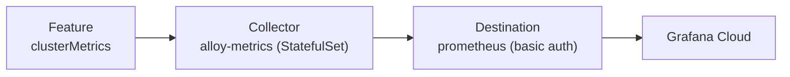

# Grafana Alloy no Kubernetes com o Helm chart `k8s-monitoring`

Anotações do que aprendi no lab **"Installing Grafana Alloy via the Kubernetes Monitoring Helm Chart"**, da **Grot Academy** (Grafana Labs).

> 📚 Este repo é um registro pessoal de estudo, escrito com as minhas palavras. O conteúdo original do curso pertence à Grafana Labs.

> ⚠️ O lab usa o chart **v3, fixado na versão `3.8.8`**. Já existe a v4, com *breaking changes*, então os values e comandos daqui podem não funcionar nela sem ajustes.

---

## O que é o chart `k8s-monitoring`?

É o Helm chart que sobe um cluster de **Grafana Alloy** dentro do Kubernetes para coletar telemetria e enviá-la ao **Grafana Cloud**. Além do Alloy, ele instala componentes auxiliares e já traz boas práticas de configuração.

Na saída da instalação, vi que ele criou: Grafana Alloy Operator, kube-state-metrics (Deployment), Node Exporter (DaemonSet), Windows Exporter (DaemonSet) e o `alloy-metrics` (StatefulSet).

## Os três conceitos principais

| Conceito | O que é | No lab |
| --- | --- | --- |
| **Collector** | Workload com containers Alloy dedicados a coletar um tipo de telemetria | `alloy-metrics` |
| **Feature** | Configuração pronta que *gera* a telemetria. O collector sozinho não gera métricas do cluster | `clusterMetrics` |
| **Destination** | Para onde a telemetria é enviada | Prometheus do Grafana Cloud |



## Pré-requisitos

- Cluster Kubernetes com `kubectl` configurado (no lab já vem pronto)
- `helm` instalado
- Conta no Grafana Cloud (o plano gratuito serve)

## Passo a passo

### 1. Montar o arquivo de values

Crie um arquivo `k8s-monitoring-values.yaml` com quatro blocos: nome do cluster, collector, feature e destination. Por padrão o chart vem com **tudo desabilitado**, então só ligamos o que precisamos.

```yaml
# 1) Nome que identifica o cluster no Grafana Cloud
cluster:
  name: "alloy-with-kubernetes"

# 2) Collector: Alloy em StatefulSet que coleta e envia as métricas
alloy-metrics:
  enabled: true
  service:
    type: LoadBalancer # expõe a Alloy UI (porta 12345)

# 3) Feature: o que de fato gera/coleta as métricas do cluster
#    (cAdvisor, kubelet, API server, nodes...)
clusterMetrics:
  enabled: true

# 4) Destination: para onde as métricas são enviadas
destinations:
  - name: grafana-hosted-metrics
    type: prometheus
    url: https://<SEU-ENDPOINT-PROMETHEUS>.grafana.net/api/prom/push
    auth:
      type: basic
      username: "<ID_DO_SEU_STACK>" # passado no helm via --set-string (passo 3)
      password: "<SEU_TOKEN>"       # idem: nunca commitar o token real
```

### 2. Gerar as credenciais no Grafana Cloud

1. Entre no Grafana Cloud, localize o seu stack e clique em **Details**.
2. No bloco **Prometheus**, clique em **Send Metrics**.
3. Em **Generate now**, dê um nome ao token e clique em **Create token**. **Copie na hora**: ele não aparece de novo.
4. Anote também a **URL** e o **username** (o ID do stack) mostrados na página.

### 3. Instalar o chart

```bash
helm repo add grafana https://grafana.github.io/helm-charts
helm repo update

export GRAFANA_CLOUD_USER="<ID_DO_SEU_STACK>"
export GRAFANA_CLOUD_TOKEN="<SEU_TOKEN>"

helm upgrade --install k8s-monitoring grafana/k8s-monitoring \
  --version 3.8.8 \
  -f k8s-monitoring-values.yaml \
  --set-string "destinations[0].auth.username=${GRAFANA_CLOUD_USER}" \
  --set-string "destinations[0].auth.password=${GRAFANA_CLOUD_TOKEN}"
```

Lembre de trocar também a `url` no values pelo endpoint do seu stack.

### 4. Conferir se o Alloy está saudável

```bash
kubectl get pods
kubectl get svc
```

Com `service.type: LoadBalancer` no `alloy-metrics`, a **Alloy UI** fica exposta na porta `12345`. Ela mostra o status dos componentes, a configuração aplicada e o fluxo da telemetria até a nuvem. Se o LoadBalancer não estiver disponível, dá para usar um `port-forward` (confira o nome do service com `kubectl get svc`):

```bash
kubectl port-forward svc/k8s-monitoring-alloy-metrics 12345:12345
```

### 5. Ver as métricas no Grafana Cloud

1. Abra o seu stack (**Launch**).
2. No menu, vá em **Observability → Kubernetes** e clique em **Activate**.
3. O dashboard de overview deve aparecer com os dados do cluster. Se vier vazio, revise o values e reaplique o `helm upgrade`.

## 🔐 Segurança

- **Não commite o token** nem o username reais. Aqui eles ficam como placeholders e são passados via variáveis de ambiente.
- Se você guardar um values com credenciais reais na sua máquina, mantenha esse arquivo fora do repo (por exemplo, listando-o no `.gitignore`).
- Se um token vazar, **revogue** em Grafana Cloud → Access Policies e gere outro.

## O que eu aprendi

- O chart vem **tudo desabilitado**, e é isso que mantém a configuração inicial simples.
- **Collector não gera métrica**: quem gera são as *features*. O collector só coleta e encaminha.
- O `alloy-metrics` usa **StatefulSet** por causa do **WAL** (*write-ahead log*): se o pod cair, as métricas ainda não enviadas ficam em disco e são enviadas quando ele voltar.
- A **Alloy UI** é a forma mais prática de debugar além do `kubectl get pods` e `kubectl logs`.
- O `destination` aceita qualquer destino compatível com os protocolos suportados, não só o Grafana Cloud.

## Referências

- Chart: [grafana/k8s-monitoring-helm](https://github.com/grafana/k8s-monitoring-helm)
- Repo de charts: <https://grafana.github.io/helm-charts>
- Grot Academy / Grafana Labs

---

*Estudado em 24/10/2026.*
